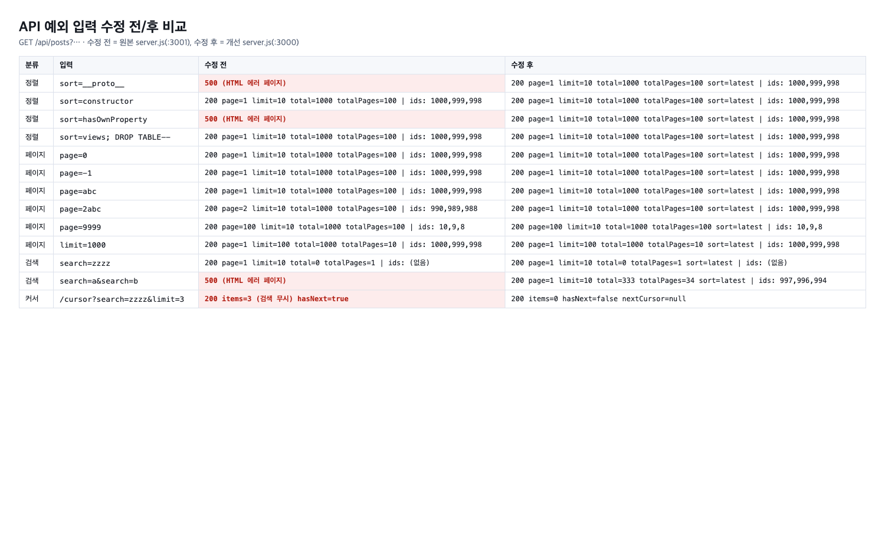
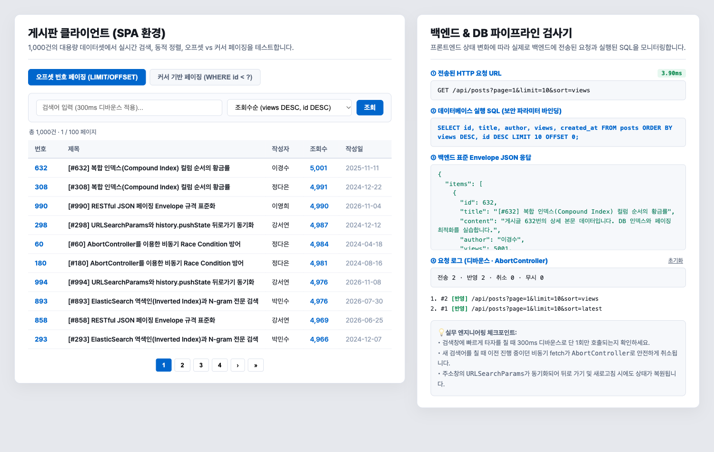
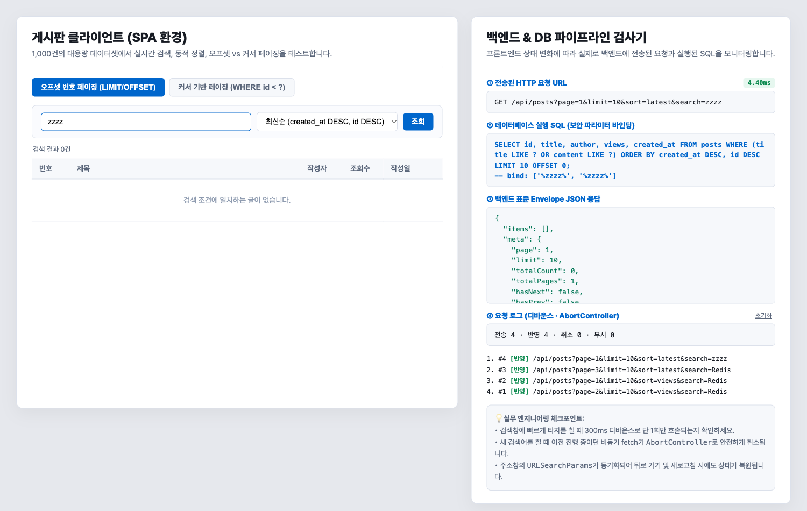
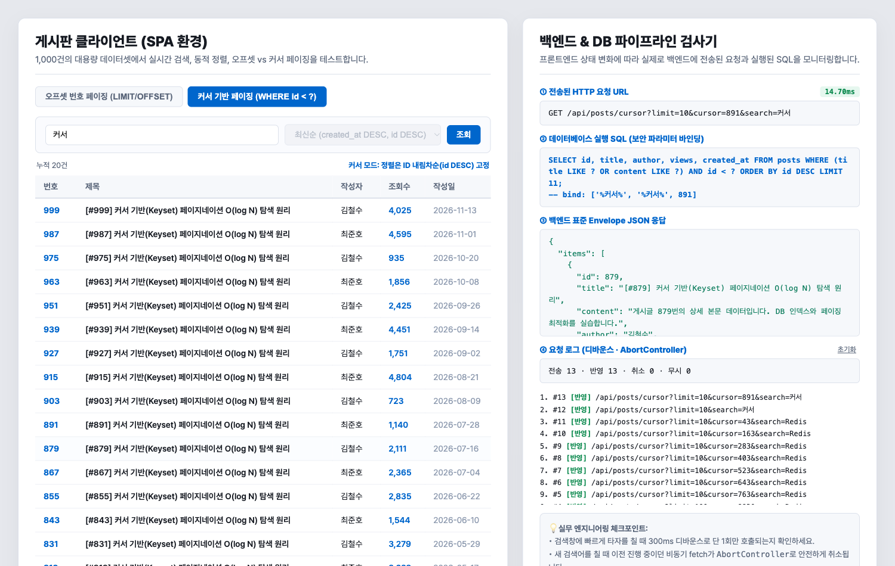
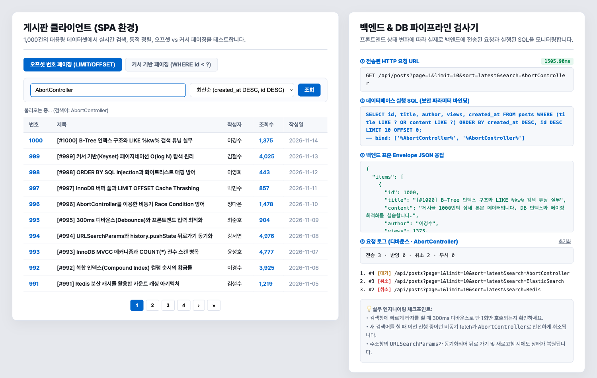
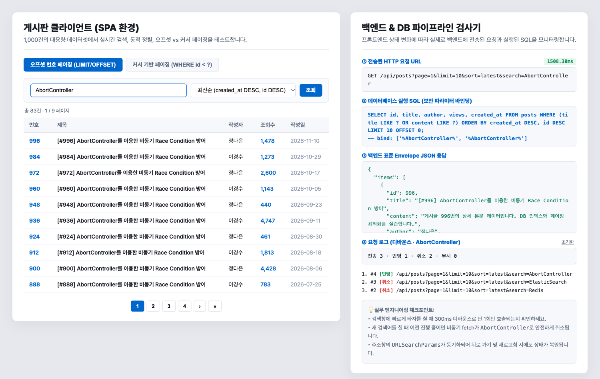
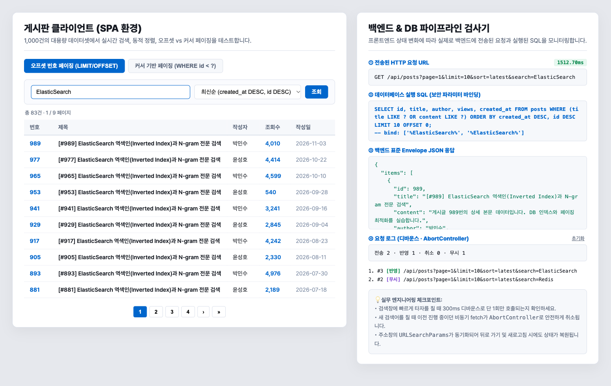
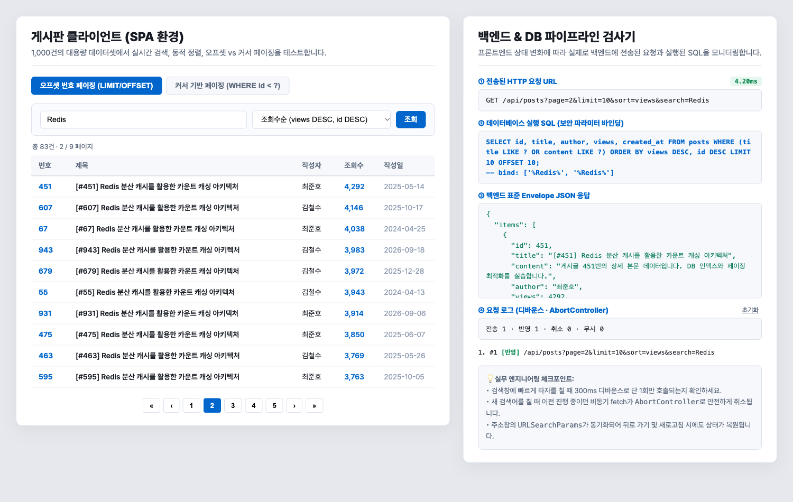
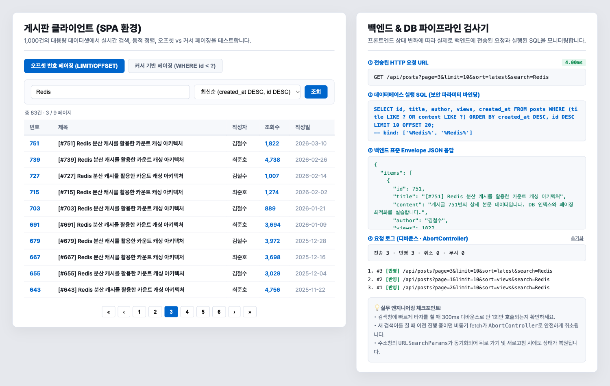

# 9주차 실습 2 보고서: 검색·정렬·페이지네이션 게시판 개선

| 항목 | 내용 |
|---|---|
| 과목 | 웹서비스설계 |
| 이름 / 학번 | 박준이 / |
| GitHub | https://github.com/junyi11111/week09-board-search-pagination |
| 실행 환경 | macOS, Node.js v26.8.2, Express 5, Chromium |

이번 실습은 제공된 예제를 먼저 실행해서 요구사항대로 동작하는지 확인하고, 문제가 있는 부분을 고친 뒤 다시 테스트하는 순서로 진행했다. 원본 코드는 저장소의 첫 커밋에 그대로 올려 두었기 때문에 이후 커밋을 보면 어떤 부분을 바꿨는지 확인할 수 있다. 코드 안에서 수정한 곳에는 `[수정]` 주석을 달았다.

## 1. 원본 코드 실행 결과

예제를 실행한 뒤 주소창에 여러 가지 잘못된 값을 직접 넣어 보았다. 정상 입력에서는 대부분 문제없이 동작했지만, 아래와 같이 서버 오류가 나거나 요구사항을 만족하지 못하는 경우가 있었다.

| 입력 | 원본 결과 | 원인 |
|---|---|---|
| `sort=__proto__` | 500 에러 | `SORT_WHITELIST['__proto__']`가 함수가 아닌 `Object.prototype`을 돌려주어 `sort()`에서 TypeError 발생 |
| `sort=hasOwnProperty` | 500 에러 | 상속 메서드가 비교 함수로 넘어감 |
| `sort=constructor` | 200 | 화이트리스트를 통과해서 `Object` 함수가 비교 함수로 쓰임. 결과가 우연히 최신순과 같았을 뿐임 |
| `page=2abc` | 2페이지 | `parseInt`가 앞의 숫자만 읽음 |
| `search=a&search=b` | 500 에러 | 같은 키가 두 번 오면 배열이 되는데, 배열에 `.trim()`을 호출함 |
| `/api/posts/cursor?search=zzzz` | 3건 반환 | 커서 API에 검색 기능이 없음 |
| 화면의 커서 모드 | 정렬을 바꿀 수 있지만 결과는 그대로 | 커서는 id 순서로만 동작하는데 화면에서 이를 막지 않음 |
| 주소창에 `?sort=__proto__` | 정렬 선택 상자가 빈칸이 됨 | URL 값을 검증하지 않음 |

데이터에도 테스트를 어렵게 하는 점이 있었다. 조회수가 `Math.random()`으로 만들어져서 서버를 켤 때마다 값이 바뀌었고, 작성일이 id 순서와 맞지 않아 최신순 화면에서 날짜가 뒤섞여 보였다.



## 2. 검색과 정렬

| 번호 | 테스트 입력 | 기대 결과 | 실제 결과 |
|---|---|---|---|
| 2-1 | `search=Redis` (제목 검색) | 제목에 Redis가 있는 글만 나옴 | 83건, 모두 제목에 Redis 포함 |
| 2-2 | `search=게시글 777번` (본문 검색) | 본문에만 있는 문구라 777번 1건 | 1건, id 777 |
| 2-3 | `search=zzzz` | 빈 목록과 안내 문구 | "검색 조건에 일치하는 글이 없습니다." 표시, 페이지 버튼 숨김 |
| 2-4 | `sort=latest` | id 내림차순 | 1000, 999, 998 순 |
| 2-5 | `sort=oldest` | id 오름차순 | 1, 2, 3 순 |
| 2-6 | `sort=views` | 조회수 내림차순, 같으면 id 내림차순 | 994번과 893번이 둘 다 4,976회인데 994번이 먼저 나옴. 1,000건 전체에서 동점인 경우를 모두 확인함 |
| 2-7 | `sort=views; DROP TABLE posts--` | latest로 처리 | 200, 최신순 |
| 2-8 | `sort=__proto__`, `constructor`, `hasOwnProperty`, `toString`, `valueOf` | latest로 처리 | 모두 200, 최신순 |
| 2-9 | 주소창 `?sort=__proto__&page=-1&search=Redis` | 최신순 1페이지로 바뀜 | 주소가 `?search=Redis&sort=latest&page=1`로 바뀌고 선택 상자도 최신순 |






### 수정한 내용

가장 큰 문제는 정렬 화이트리스트가 일반 객체라서 `__proto__`나 `constructor`처럼 모든 객체가 물려받는 속성까지 통과된다는 점이었다. 그래서 화이트리스트를 `Object.create(null)`로 만들어 상속받는 속성이 아예 없게 했고, 키를 꺼내기 전에 `Object.hasOwn()`으로 직접 정의한 키인지 한 번 더 확인했다(`server.js:80`, `server.js:107`). 이 두 조건을 통과하지 못하면 모두 latest로 처리한다.

```js
// 수정 전
const sortComparator = SORT_WHITELIST[sortKey] || SORT_WHITELIST.latest;
// 수정 후
return Object.hasOwn(SORT_WHITELIST, key) ? key : 'latest';
```

`search=a&search=b`처럼 같은 키가 여러 번 들어오는 경우는 `single()` 함수에서 첫 번째 문자열만 쓰도록 바꿔서 500 에러가 나지 않게 했다(`server.js:92`). 응답의 `meta`에는 실제로 적용된 `sort`와 `search` 값을 함께 넣어서, 잘못된 값이 들어왔을 때 서버가 어떻게 처리했는지 바로 볼 수 있게 했다.

조회수는 시드를 고정한 난수로 바꿔서 서버를 다시 켜도 같은 값이 나오게 했고, 작성일은 id가 클수록 최근 날짜가 되도록 맞췄다. 화면 쪽(`index.html:372`)에서도 주소창의 sort 값을 latest, views, oldest 중 하나인지 확인한 뒤 사용한다.

## 3. 페이지네이션

### 3-1. 오프셋 방식

| 번호 | 테스트 입력 | 기대 결과 | 실제 결과 |
|---|---|---|---|
| 3-1 | `page=3&limit=10` | 980~971번, totalPages 100 | 일치, hasNext와 hasPrev 모두 true |
| 3-2 | `page=100` | 마지막 페이지 10~1번 | 일치, hasNext false |
| 3-3 | `page=0`, `page=-1`, `page=abc` | 1페이지 | 모두 1페이지 |
| 3-4 | `page=2abc`, `page=1.5` | 정수가 아니라서 1페이지 | 1페이지 (원본은 `2abc`를 2페이지로 처리) |
| 3-5 | `page=9999` | 마지막 페이지 | 100페이지, 화면에서는 주소도 `page=100`으로 바뀜 |
| 3-6 | `limit=1000` | 최대 100개 | limit 100, totalPages 10 |
| 3-7 | `limit=0`, `-5`, `abc` | 기본값 10 | limit 10 |
| 3-8 | Redis 검색 후 3페이지에서 정렬을 조회순으로 변경 | 1페이지로 돌아감 | 주소 `?search=Redis&sort=views&page=1` |
| 3-9 | 오래된순 4페이지에서 검색어 입력 | 1페이지로 돌아감 | 1페이지 |


### 3-2. 커서 방식

| 번호 | 테스트 입력 | 기대 결과 | 실제 결과 |
|---|---|---|---|
| 3-10 | `/cursor?search=zzzz` | 검색이 적용되어 0건 | 0건, hasNext false, nextCursor null (원본은 검색을 무시하고 3건) |
| 3-11 | 검색 없이 30개씩 끝까지 요청 | 1,000건, 빠지거나 겹치는 글 없음 | 34번 요청해서 1,000건, 중복 없음 |
| 3-12 | `인덱스`, `Redis`, `게시글 5`, `커서`로 검색하며 7개씩 끝까지 요청 | 오프셋으로 전체 검색한 결과와 같음 | 네 경우 모두 같음 |
| 3-13 | 결과가 정확히 11건인 검색(`게시글 77`)을 limit 11과 10으로 요청 | 11이면 hasNext false, 10이면 true | 일치 |
| 3-14 | 화면에서 Redis 검색 후 더 보기를 끝까지 누름 | 83건, 마지막에 버튼 비활성화 | 8번 눌러 83건, 중복 없음, 버튼이 "더 이상 글이 없습니다"로 바뀌고 눌리지 않음 |
| 3-15 | 커서 모드에서 검색어를 "커서"로 변경 | 쌓인 목록과 커서가 초기화됨 | 목록이 999번부터 10건으로 다시 시작, 다음 요청은 `cursor=891&search=커서` |
| 3-16 | 커서 탭 선택 | 정렬을 바꿀 수 없고 기준이 보임 | 선택 상자 비활성화, "정렬은 ID 내림차순(id DESC) 고정" 문구 표시 |
| 3-17 | `cursor=abc`, `-1`, `0` / `limit=1000` | 첫 페이지 / 최대 50개 | 일치 |




### 수정한 내용

page, limit, cursor 값은 `parsePositiveInt()`에서 숫자로만 이루어진 양의 정수일 때만 받아들이게 했다(`server.js:99`). `parseInt`는 `2abc`를 2로 읽기 때문에 정규식 `/^\d+$/`로 먼저 검사하는 방식으로 바꿨다.

커서 API에는 제목과 본문 검색을 추가했다(`server.js:183`). 검색 조건과 `id < cursor` 조건을 먼저 적용하고, id 내림차순으로 정렬한 다음 limit보다 1개 더 잘라서 다음 페이지가 있는지 판단한다. 다음 페이지가 없을 때는 nextCursor를 null로 보낸다.

```js
// SQL로 쓰면 WHERE (title LIKE ? OR content LIKE ?) AND id < ? ORDER BY id DESC LIMIT limit + 1
const candidate = POSTS
  .filter(p => matchSearch(p, search) && (cursor === null || p.id < cursor))
  .sort((a, b) => b.id - a.id);
const sliced = candidate.slice(0, limit + 1);
const hasNext = sliced.length > limit;
```

화면에서는 커서 요청에도 검색어를 붙여서 보내도록 했다(`index.html:460`). 커서 모드에서는 정렬 선택 상자를 비활성화하고 정렬 기준을 문구로 보여 준다(`index.html:416`). 검색어나 정렬이 바뀌면 `setSearch()`에서 페이지를 1로 돌리고 커서와 누적 목록을 비운다(`index.html:650`). 더 보기 버튼은 응답을 기다리는 동안과 hasNext가 false일 때 눌리지 않게 했는데, 이렇게 하면 버튼을 빠르게 두 번 눌러서 같은 커서로 요청이 두 번 가는 문제도 막을 수 있다(`index.html:534`). 그 밖에 결과가 없을 때는 페이지 버튼을 숨기고, 표 위에 "총 83건 · 3 / 9 페이지"처럼 현재 상태를 보여 주는 줄을 추가했다.

## 4. 비동기 처리

| 번호 | 테스트 입력 | 기대 결과 | 실제 결과 |
|---|---|---|---|
| 4-1 | "Redis 분산" 8글자를 100ms 간격으로 입력 | 입력이 끝나고 약 300ms 뒤 요청 1번 | 마지막 입력 309ms 뒤 요청 1번 |
| 4-2 | 응답을 1.5초씩 늦춘 서버에서 검색어를 Redis, ElasticSearch, AbortController 순으로 0.7초 간격으로 변경 | 앞의 요청 2개가 취소됨 | Redis와 ElasticSearch 요청이 취소(ERR_ABORTED)되고 콘솔에 취소 로그 2번 |
| 4-3 | 4-2의 최종 화면 | 마지막 검색어 결과만 표시 | 주소, 입력창, 목록 모두 AbortController 기준 |
| 4-4 | 취소된 요청 | 에러 화면이 뜨지 않음 | 요청 로그에만 "취소"로 기록 |
| 4-5 | abort가 동작하지 않도록 막고, Redis 응답만 3초 늦게 도착하게 함 | 늦게 온 Redis 응답은 무시 | Redis 응답은 "무시"로 기록되고 화면은 ElasticSearch 결과 유지 |

느린 네트워크는 서버를 `DELAY_MS=1500 node server.js`로 실행해서 만들었다. 4-5번은 abort만으로는 막지 못하는 경우(응답이 이미 도착한 직후에 새 요청이 생기는 경우)를 확인하려고, 테스트할 때만 abort 기능을 일부러 꺼 두고 진행했다.








### 수정한 내용

디바운스는 원본 구조를 그대로 두고 몇 가지를 보완했다(`index.html:665`). 조회 버튼이나 Enter로 바로 검색하면 기다리고 있던 디바운스 타이머를 취소해서 같은 요청이 두 번 가지 않게 했다. 뒤에 공백만 붙이는 것처럼 검색어가 실제로 바뀌지 않았을 때는 요청을 보내지 않는다. 한글을 조합하는 중에 누른 Enter는 무시한다.

`loadData()`에서는 요청마다 번호를 붙이고, 응답이 왔을 때 가장 최근 요청의 번호가 아니면 화면에 반영하지 않도록 했다(`index.html:479`). 원본도 AbortController로 이전 요청을 취소하고 있었지만, 응답이 이미 도착한 직후라면 취소가 늦을 수 있어서 한 번 더 확인하는 장치를 둔 것이다. 또 요청을 보낼 때의 조건을 따로 복사해 두고 그 값으로 화면을 그려서, 응답을 기다리는 사이에 상태가 바뀌어도 서로 섞이지 않게 했다.

AbortError는 오류가 아니라 정상적인 취소로 보고 기록만 남긴다(`index.html:513`). 반대로 원본은 서버가 오류 코드를 보내도 확인하지 않았기 때문에 `res.ok`를 검사해서 오류 메시지를 표시하도록 했다. 서버에는 `DELAY_MS`, `JITTER_MS` 환경변수를 추가해서 느린 네트워크를 쉽게 재현할 수 있게 했다. 오른쪽 검사기에는 요청 로그를 추가해서 요청이 반영됐는지, 취소됐는지, 무시됐는지를 화면에서 바로 볼 수 있다.

## 5. URL 상태 복원

| 번호 | 테스트 입력 | 기대 결과 | 실제 결과 |
|---|---|---|---|
| 5-1 | Redis 검색, 조회순, 2페이지 | 주소 `?search=Redis&sort=views&page=2` | 일치 |
| 5-2 | 5-1에서 새로고침 | 주소, 입력창, 정렬, 결과 유지 | 모두 유지 |
| 5-3 | 5-2에서 뒤로 가기 2번 | 이전 상태(최신순 3페이지) | 주소, 정렬, "총 83건 · 3 / 9 페이지" 모두 일치 |
| 5-4 | 여러 번 이동한 뒤 뒤로 가기 3번, 앞으로 가기 1번 | 단계마다 주소와 화면이 일치 | 검색어가 있고 없는 경우까지 입력창에 맞게 반영됨 |
| 5-5 | `?sort=constructor&page=abc`, `?sort=views&page=9999` | 최신순 1페이지 / 조회순 100페이지 | 주소가 각각 `?sort=latest&page=1`, `?sort=views&page=100`으로 바뀜 |





### 수정한 내용

주소창의 값은 사용자가 마음대로 바꿀 수 있으므로 `readUrlState()`에서 page와 sort를 검사한 뒤 사용한다(`index.html:372`). 주소를 바꾸는 부분은 `syncUrl()`로 정리했다(`index.html:391`). 검색, 정렬, 페이지 이동처럼 사용자가 직접 한 동작은 `pushState`로 기록하고, 처음 접속했을 때나 서버가 값을 고쳐서 돌려준 경우(9999페이지를 100페이지로 바꾼 경우 등)는 `replaceState`로 현재 기록만 바꾼다. 원본은 주소가 같아도 매번 기록을 추가해서 뒤로 가기를 여러 번 눌러야 했는데, 이제는 주소가 같으면 기록하지 않는다.

뒤로 가기(popstate)를 하면 기다리던 디바운스를 취소하고, 주소에서 상태를 읽어 입력창과 정렬에 반영한 뒤 다시 요청한다(`index.html:681`). 커서 모드에서 뒤로 가기를 누르면 오프셋 모드로 돌아온다. 과제 요구사항에 맞춰 주소와 동기화하는 것은 오프셋 모드만이고, 커서 모드에서 쌓인 목록은 주소에 저장하지 않는다.

## 6. 응답 시간

서버의 `X-Response-Time` 헤더를 요청마다 5번씩 측정했다. 1,000건짜리 배열을 메모리에서 처리하는 환경이라 실제 DB와는 차이가 있다.

| 요청 | 측정값 |
|---|---|
| `/api/posts?page=1` | 0.05 ~ 0.08ms |
| `/api/posts?page=100` | 0.05 ~ 0.06ms |
| `/api/posts?sort=views` | 0.20 ~ 0.23ms |
| `/api/posts?search=Redis` | 0.36 ~ 0.39ms |
| `/api/posts/cursor` (첫 페이지) | 0.04 ~ 0.10ms |
| `/api/posts/cursor?cursor=11` | 0.02 ~ 0.03ms |
| `/api/posts/cursor?search=Redis` | 0.38 ~ 0.39ms |

요청할 때마다 배열 전체를 거르고 정렬하기 때문에 1페이지와 100페이지의 차이는 거의 없었고, 검색이나 조회순 정렬이 들어갈 때 조금 더 오래 걸렸다. 실제 DB라면 OFFSET이 커질수록 건너뛰어야 하는 행이 많아져서 뒤쪽 페이지가 느려지겠지만, 이번 실습 환경에서는 그 차이가 나타나지 않았다.

## 7. 개념 정리

### 오프셋과 커서에 맞는 화면

오프셋 방식은 페이지 번호가 있는 게시판이나 관리자용 목록처럼 원하는 페이지로 바로 이동하거나 전체 개수를 보여 줘야 하는 화면에 맞다. 다만 뒤쪽 페이지로 갈수록 앞의 데이터를 건너뛰는 비용이 커지고, 보는 도중에 글이 추가되거나 삭제되면 같은 글이 두 번 나오거나 빠질 수 있다.

커서 방식은 SNS 피드, 댓글, 알림처럼 아래로 계속 내려가며 보는 무한 스크롤 화면에 맞다. 마지막으로 받은 글의 id를 기준으로 다음 데이터를 찾기 때문에 아무리 뒤쪽이어도 인덱스로 바로 찾을 수 있고, 중간에 새 글이 생겨도 목록이 밀리지 않는다. 대신 특정 페이지로 바로 이동할 수 없고, 정렬 기준이 id처럼 겹치지 않는 값이어야 한다.

### 디바운스와 요청 취소

디바운스는 입력이 멈추고 300ms 동안 추가 입력이 없을 때만 요청을 보내는 방법이다. 실제로 8글자를 빠르게 쳤을 때 요청은 1번만 나갔다. 요청 개수 자체를 줄이는 역할을 한다.

요청 취소는 이미 보낸 요청끼리 겹칠 때 필요하다. 네트워크가 느리면 디바운스를 거친 요청도 응답이 오기 전에 다음 요청이 나갈 수 있고, 먼저 보낸 요청의 응답이 나중에 도착하면 최신 결과를 덮어써 버린다. AbortController로 이전 요청을 취소하면 이런 문제와 불필요한 네트워크 사용을 막을 수 있다. 정리하면 디바운스는 요청 수를 줄이고, 요청 취소는 남은 요청끼리의 순서 문제를 해결한다.

### limit + 1 원리

10개를 보여 줄 때 11개를 조회하는 방법이다. 11개가 오면 다음 데이터가 있다는 뜻이므로 hasNext를 true로 두고 마지막 1개는 버린 뒤 10개만 보낸다. 10개 이하로 오면 그대로 보내고 hasNext는 false가 된다. 이렇게 하면 전체 개수를 세는 COUNT 쿼리 없이도 더 보기 버튼을 보여 줄지 정할 수 있다.

### offset과 totalPages 계산식

```
offset     = (page - 1) × limit
totalPages = max(1, ceil(totalCount / limit))
```

결과가 0건이어도 totalPages는 1로 둔다. 요청한 page가 totalPages보다 크면 마지막 페이지로 바꾼다. 예를 들어 Redis 검색 결과 83건을 10개씩 나누면 totalPages는 ceil(83 / 10) = 9이다. 3페이지의 offset은 20이므로 21번째부터 30번째 글이 나오고, 9페이지에는 마지막 3건이 나온다.

## 8. 자동 테스트

API 동작은 `test/api.test.js`에 테스트 37개로 작성했다. `npm test`로 실행할 수 있고, 모두 통과했다.


## 9. AI 활용 및 직접 검증

이번 실습에서는 Claude Code(Anthropic)를 사용했다. 원본 코드에서 문제를 찾는 과정, server.js와 index.html 수정, 테스트 코드 작성, 브라우저 테스트와 캡처, 보고서 초안 작성에 활용했다.

AI가 작성한 코드와 결과는 아래 항목을 직접 실행해서 확인했다.

| 확인한 내용 | 결과 |
|---|---|
| `npm install` 후 `node server.js`로 실행하고 http://localhost:3000 접속 | |
| 검색창에 빠르게 입력했을 때 요청 로그에 1번만 전송되는지 | |
| `DELAY_MS=1500 node server.js`로 실행하고 검색어를 연달아 바꿨을 때 이전 요청이 취소되고 마지막 결과만 남는지 | |
| 주소창에 `?sort=__proto__&page=-1`을 넣었을 때 최신순 1페이지로 바뀌는지 | |
| 새로고침과 뒤로 가기 후 입력창, 정렬, 페이지가 주소와 같은지 | |
| `npm test` 37개 통과 | |
