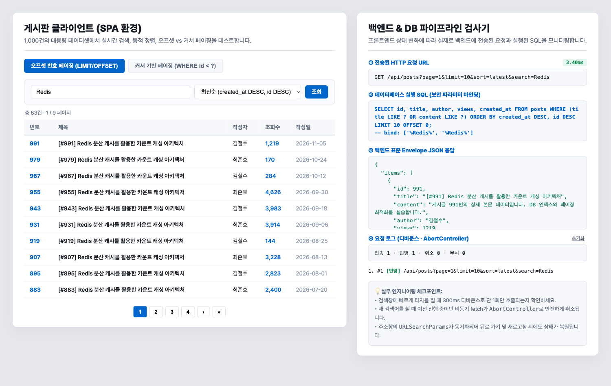
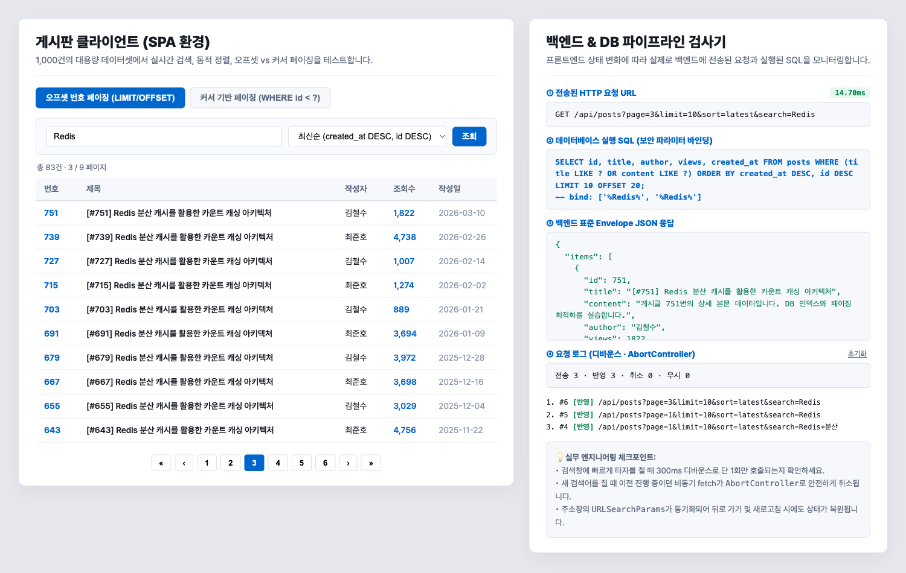
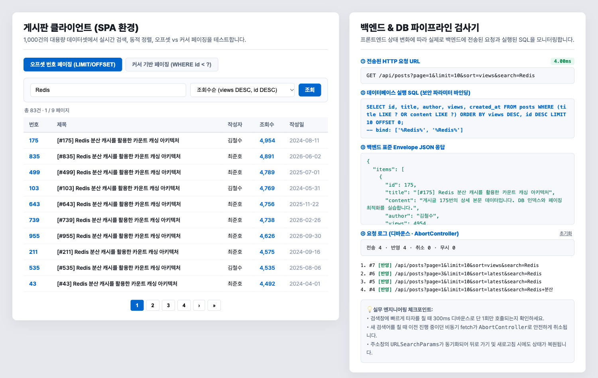
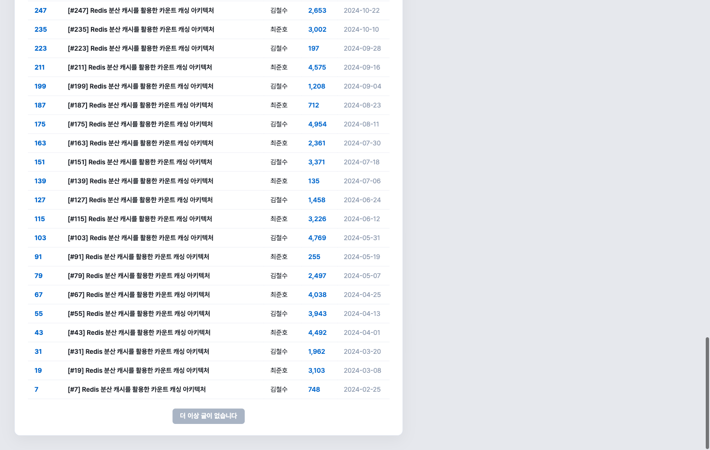
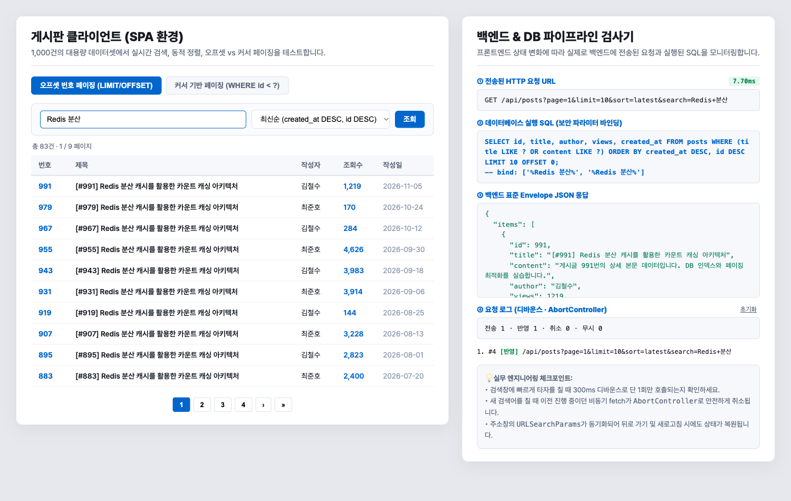
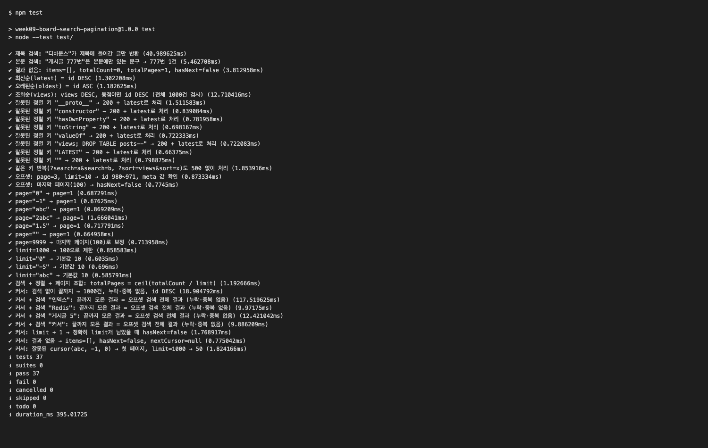

# WEEK 09 · 실습 2 보고서 — 검색·정렬·페이지네이션 게시판 개선

- 과목: 웹서비스설계
- 이름: 박준이 / 학번: ( )
- GitHub: https://github.com/junyi11111/week09-board-search-pagination
- 실행 환경: macOS, Node.js v26.8.2, Express 5, Chromium(Playwright)
- 진행 순서: ① 원본 실행·기능 검증 → ② 코드 개선 → ③ 재검증·결과 설명

---

## 1. 원본 코드 검증 결과 (수정 전)

원본 `server.js`를 실행하고(`git show 5190422:server.js`) 예외 입력을 넣어 확인한 결과입니다.

| 입력 | 원본 결과 | 문제 |
|---|---|---|
| `sort=__proto__` | **500 Internal Server Error** | `SORT_WHITELIST['__proto__']`가 `Object.prototype`(함수가 아닌 객체)을 반환해 `sort()`에서 TypeError가 발생 |
| `sort=hasOwnProperty` | **500** | 상속 메서드가 비교 함수로 넘어감 |
| `sort=constructor` | 200, 하지만 `Object` 함수가 비교 함수로 사용됨 | 화이트리스트를 우회함 (결과가 우연히 latest와 같았을 뿐) |
| `page=2abc` | 2페이지 | `parseInt`가 앞의 숫자만 읽음 |
| `search=a&search=b` | **500** | Express가 배열로 파싱 → 배열에 `.trim()`을 호출해 에러 |
| `/api/posts/cursor?search=zzzz` | 3건 반환 | 커서 API에 검색 기능이 없음 |
| 화면: 커서 모드 | 정렬 선택이 가능하지만 반영 안 됨, 검색어를 서버에 보내지 않음 | 요구사항 미충족 |
| 화면: `?sort=__proto__` 직접 입력 | 정렬 선택 상자가 빈칸 | URL 값 검증 없음 |
| 데이터 | 조회수가 실행할 때마다 바뀜, 작성일이 id 순서와 다름 | 테스트 재현 어려움, "최신순" 화면 날짜가 뒤섞임 |


---

## 2. 검색·정렬 (25점)

| # | 테스트 입력 | 기대 결과 | 실제 결과 | 캡처 |
|---|---|---|---|---|
| 2-1 | 제목 검색 `search=Redis` | 제목에 Redis가 들어간 글만 | 83건, 모든 제목에 "Redis" 포함 | 04-search-page3 |
| 2-2 | 본문 검색 `search=게시글 777번` | 본문에만 있는 문구로 검색 → 777번 1건 | totalCount=1, id=777 | npm test |
| 2-3 | 결과 없음 `search=zzzz` | 빈 목록 + 안내 문구, 페이지 버튼 없음 | "검색 조건에 일치하는 글이 없습니다.", "검색 결과 0건", totalPages=1, hasNext=false | 06-no-result |
| 2-4 | `sort=latest` | id 내림차순 | 1000, 999, 998 … | 01-initial |
| 2-5 | `sort=oldest` | id 오름차순 | 1, 2, 3 … | npm test |
| 2-6 | `sort=views` | 조회수 내림차순, **동점이면 id DESC** | 5,001(632) → 4,991(308) → … → **4,976(994) → 4,976(893)**: 동점에서 id 큰 994가 먼저. 1,000건 전체를 검사해 동점 쌍 모두 id DESC 확인 | 02-sort-views, npm test |
| 2-7 | `sort=views; DROP TABLE posts--`, `LATEST`, 빈 값 | latest로 처리 | 200, `meta.sort=latest`, 1000, 999, 998 | 00, npm test |
| 2-8 | `sort=__proto__`, `constructor`, `hasOwnProperty`, `toString`, `valueOf` | 상속 속성 차단 → latest | 모두 200, `meta.sort=latest` (원본: 500 또는 우회) | 00, npm test |
| 2-9 | 화면 URL `?sort=__proto__&page=-1&search=Redis` | 정렬 latest, 1페이지로 보정 | URL이 `?search=Redis&sort=latest&page=1`로 교체, 선택 상자 "최신순" | 07-bad-url-normalized |

**캡처**




**수정 내용**

- `server.js:80` `SORT_WHITELIST`를 `Object.create(null)`로 만들어 프로토타입이 없게 하고, `server.js:107` `parseSort()`에서 `Object.hasOwn(SORT_WHITELIST, key)`일 때만 허용합니다. 나머지는 모두 `latest`입니다.
  ```js
  // 수정 전
  const sortComparator = SORT_WHITELIST[sortKey] || SORT_WHITELIST.latest;
  // 수정 후
  return Object.hasOwn(SORT_WHITELIST, key) ? key : 'latest';
  ```
- `server.js:92` `single()`: 같은 키가 반복되어 배열로 들어와도 첫 문자열만 사용하게 해서 500 에러를 막았습니다.
- 응답 `meta`에 실제 적용된 `sort`·`search`를 넣어 화면과 테스트에서 확인할 수 있게 했습니다.
- 조회수를 시드 고정 난수로 만들어 서버를 재시작해도 위 결과가 똑같이 재현됩니다. 작성일도 id 순서와 맞췄습니다.
- 화면(`index.html:372` `readUrlState`)도 URL의 `sort`를 `['latest','views','oldest']`로 검증합니다.

---

## 3. 페이지네이션 (35점)

### 3-1. 오프셋

| # | 테스트 입력 | 기대 결과 | 실제 결과 | 캡처 |
|---|---|---|---|---|
| 3-1 | `page=3&limit=10` | id 980~971, page=3, totalCount=1000, totalPages=100, hasNext·hasPrev=true | 일치 | npm test |
| 3-2 | `page=100` (마지막) | id 10~1, hasNext=false | 일치 | npm test |
| 3-3 | `page=0`, `page=-1`, `page=abc` | 1페이지 | 모두 page=1, 첫 글 1000 | 00 |
| 3-4 | `page=2abc`, `page=1.5` | 정수가 아니므로 1페이지 | page=1 (원본: `2abc` → 2페이지) | 00 |
| 3-5 | `page=9999` | 마지막 페이지(100)로 보정 | page=100. 화면에서는 URL도 `page=100`으로 교체 | 00 |
| 3-6 | `limit=1000` | 상한 100 | limit=100, totalPages=10 | 00 |
| 3-7 | `limit=0`, `-5`, `abc` | 기본값 10 | limit=10 | npm test |
| 3-8 | 화면: Redis 검색 → 3페이지 → 정렬을 조회순으로 변경 | 1페이지로 초기화 | URL `?search=Redis&sort=views&page=1`, "총 83건 · 1 / 9 페이지" | 04-search-page3 → 04b |
| 3-9 | 화면: 오래된순 4페이지 → 검색어 입력 | 1페이지로 초기화 | page=1 | (브라우저 자동 테스트) |

### 3-2. 커서

| # | 테스트 입력 | 기대 결과 | 실제 결과 | 캡처 |
|---|---|---|---|---|
| 3-10 | `/cursor?search=zzzz` | 검색 적용 → 0건, hasNext=false | items=0, hasNext=false, nextCursor=null (원본: 검색 무시하고 3건) | 00 |
| 3-11 | 검색 없이 limit=30으로 끝까지 | 1,000건, 누락·중복 없음, id DESC, 34번 호출 | 일치 | npm test |
| 3-12 | 검색 `인덱스`, `Redis`, `게시글 5`, `커서`를 limit=7로 끝까지 | 커서로 모은 결과 = 전체 검색 결과 (누락·중복 없음) | 4개 모두 일치 | npm test |
| 3-13 | limit+1 경계: 결과가 정확히 11건인 검색(`게시글 77`)에 limit=11 / limit=10 | limit=11 → 11건, hasNext=false. limit=10 → 10건, hasNext=true | 일치 | npm test |
| 3-14 | 화면: Redis 검색 → 커서 탭 → 더 보기를 끝까지 | 83건 누적, 중복 없음, 마지막에 버튼 비활성화 | 8번 클릭 후 83건(고유 83), id 내림차순, 버튼 "더 이상 글이 없습니다"(disabled) | 08-cursor-end-hasNext-false |
| 3-15 | 화면: 커서 모드에서 검색어를 "커서"로 변경 | 누적 목록·커서 초기화 후 새 검색 1페이지 | 목록 10건으로 초기화(첫 글 999), 요청 URL에 cursor 없음 → 더 보기 시 `cursor=891&search=커서` | 09-cursor-search-reset |
| 3-16 | 화면: 커서 탭 | 정렬 선택 비활성화 + 기준 명시 | 선택 상자 disabled, "커서 모드: 정렬은 ID 내림차순(id DESC) 고정" 표시 | 08, 09 |
| 3-17 | `cursor=abc`, `-1`, `0` / `limit=1000` | 첫 페이지 / 상한 50 | 1000, 999, 998 / limit=50, order="id DESC" | npm test |

**캡처**








**수정 내용**

- `server.js:99` `parsePositiveInt()`: `/^\d+$/`에 맞는 양의 정수만 인정하고 나머지는 기본값을 씁니다(`parseInt` 대신).
- `server.js:183` 커서 API에 검색을 추가했습니다. **검색 조건과 커서 조건을 먼저 적용**한 뒤 id DESC로 정렬하고, `limit + 1`개를 잘라 hasNext를 판단합니다(`server.js:197`). 다음 페이지가 없으면 `nextCursor = null`입니다(`server.js:201`).
  ```js
  // SQL: WHERE (title LIKE ? OR content LIKE ?) AND id < ? ORDER BY id DESC LIMIT limit + 1
  const candidate = POSTS
    .filter(p => matchSearch(p, search) && (cursor === null || p.id < cursor))
    .sort((a, b) => b.id - a.id);
  const sliced = candidate.slice(0, limit + 1);
  const hasNext = sliced.length > limit;
  ```
- `index.html:460` 커서 요청에도 `search`를 붙입니다.
- `index.html:416` 커서 모드에서는 정렬 선택을 비활성화하고 기준 문구를 표시합니다.
- `index.html:650` `setSearch()`: 검색어가 바뀌면 `page=1`, `cursor=null`, 누적 목록을 비웁니다(정렬 변경도 동일).
- `index.html:534` `setLoading()`: 로딩 중이거나 `hasNext=false`면 더 보기 버튼을 비활성화합니다(로딩 중 연타로 같은 커서가 두 번 요청되는 것도 방지).
- 결과가 없으면 페이지 버튼을 숨기고, 결과 요약("총 83건 · 3 / 9 페이지", "누적 83건 · 마지막까지 불러옴")을 표시합니다.

---

## 4. 비동기 처리 (30점)

| # | 테스트 입력 | 기대 결과 | 실제 결과 | 캡처 |
|---|---|---|---|---|
| 4-1 | "Redis 분산" 8글자를 **100ms 간격**으로 입력(300ms 미만) | 마지막 입력 후 약 300ms 뒤 요청 **1회** | 요청 1회, 마지막 키 입력 후 **309ms**에 전송. 요청 로그 "전송 1 · 반영 1" | 03-debounce |
| 4-2 | 느린 서버(`DELAY_MS=1500`)에서 검색어를 Redis → ElasticSearch → AbortController로 700ms 간격 변경 | 앞의 요청 2개 취소, 마지막 결과만 표시 | Redis·ElasticSearch 요청이 `net::ERR_ABORTED`로 취소, 콘솔에 `[AbortController] 이전 비동기 요청이 정상 취소되었습니다.` 2번, 로그 "전송 3 · 반영 1 · 취소 2" | 10-slow-abort-pending |
| 4-3 | 4-2의 최종 화면 | URL·입력창·목록이 마지막 검색어와 일치 | URL `?search=AbortController&sort=latest&page=1`, 83건, 표의 모든 제목에 "AbortController" | 11-slow-abort-final |
| 4-4 | AbortError 처리 | 취소를 에러로 보지 않음 | 에러 화면 없이 로그에 [취소]로만 표시 | 10, 11 |
| 4-5 | **오래된 응답 덮어쓰기 방지**: `abort()`를 일부러 무력화하고 Redis 응답만 3초 더 늦게 도착시킴 | 늦게 온 Redis 응답은 무시, ElasticSearch 결과 유지 | 로그 "#2 [무시] …search=Redis", "전송 2 · 반영 1 · 무시 1", 목록 전부 ElasticSearch | 12-stale-response-ignored |

**캡처**




**수정 내용**

- 디바운스(`index.html:665`)는 원본 구조를 유지하고 다음을 보완했습니다.
  - 조회 버튼이나 Enter로 즉시 검색하면 대기 중인 디바운스 타이머를 취소합니다(`applySearch`, `index.html:659`). 중복 요청을 막기 위해서예요.
  - 공백만 추가한 경우처럼 검색어가 그대로면 요청하지 않습니다.
  - 한글 조합 중 Enter는 무시합니다(`isComposing`).
- `index.html:436` `loadData()`
  - 요청마다 번호(`seq`)를 붙이고, 응답이 왔을 때 최신 번호가 아니면 버립니다(`index.html:479`). `abort()`가 응답 도착 직후에 호출되는 경우까지 막는 2차 방어선이에요.
  - 요청 시점의 조건(`req`)을 복사해 두고, 렌더링은 그 조건으로 합니다. 응답을 기다리는 사이 state가 바뀌어도 섞이지 않게 하기 위해서예요.
  - `AbortError`는 정상 흐름으로 보고 기록만 남깁니다(`index.html:513`). 다른 오류는 `res.ok` 검사 후 화면에 메시지를 표시합니다.
- 서버에 `DELAY_MS`/`JITTER_MS` 환경변수를 추가해 느린 네트워크를 재현할 수 있게 했습니다(`server.js:23`).
- 검사기에 **요청 로그**(대기/반영/취소/무시)를 추가해 디바운스·취소 동작을 화면에서 바로 확인할 수 있습니다.

---

## 5. URL 상태 복원 (10점)

| # | 테스트 입력 | 기대 결과 | 실제 결과 | 캡처 |
|---|---|---|---|---|
| 5-1 | Redis 검색 → 조회순 → 2페이지 | URL `?search=Redis&sort=views&page=2` | 일치 | – |
| 5-2 | 5-1에서 **새로고침** | URL·입력창·정렬·결과 유지 | URL 동일, 입력창 "Redis", 정렬 "조회수순", 2페이지 | 05a-reload-restored |
| 5-3 | 5-2에서 **뒤로 가기 2번** | 이전 상태(최신순 3페이지)로 복원 | URL `?search=Redis&sort=latest&page=3`, 정렬 "최신순", "총 83건 · 3 / 9 페이지" | 05b-popstate-back |
| 5-4 | 뒤로 가기 3번 → 앞으로 가기 1번 (오래된순 4p → 인덱스 검색 1p → 2p 순으로 이동한 뒤) | 각 단계의 URL·입력창·정렬·페이지 일치 | 모든 단계 일치 (검색어 있음/없음까지 입력창에 반영) | (브라우저 자동 테스트) |
| 5-5 | 잘못된 URL `?sort=constructor&page=abc`, `?sort=views&page=9999` | 각각 latest·1페이지 / views·100페이지로 보정 | URL이 `?sort=latest&page=1`, `?sort=views&page=100`으로 교체 | 07-bad-url-normalized |

**캡처**


**수정 내용**

- `index.html:372` `readUrlState()`: URL 값은 사용자가 바꿀 수 있으므로 page와 sort를 검증합니다.
- `index.html:391` `syncUrl(how)`
  - 사용자 동작(검색·정렬·페이지 이동)은 `pushState`로 기록합니다.
  - 서버가 보정한 값(page 9999 → 100 등)과 첫 진입은 `replaceState`로 처리합니다.
  - 현재 URL과 같으면 기록하지 않습니다. 원본은 같은 URL도 계속 쌓아서 뒤로 가기를 여러 번 눌러야 했어요.
- `index.html:681` popstate: 대기 중인 디바운스를 취소하고, URL에서 상태를 읽어 입력창·정렬에 반영한 뒤 다시 요청합니다. 커서 모드에서 뒤로 가기를 하면 오프셋 모드로 돌아갑니다(URL은 오프셋 상태만 나타냄).
- 범위: 과제 요구대로 **오프셋 모드만** URL에 동기화합니다. 커서 모드의 누적 목록은 URL에 저장하지 않습니다.

---

## 6. 응답 시간 관찰값

1,000건 인메모리 배열 기준이며, 서버 `X-Response-Time` 헤더 5회 측정값입니다(로컬, 지연 옵션 없음). DB 인덱스 성능 비교는 범위 밖입니다.

| 요청 | X-Response-Time (5회) |
|---|---|
| `/api/posts?page=1` | 0.05 ~ 0.08ms |
| `/api/posts?page=100` | 0.05 ~ 0.06ms |
| `/api/posts?sort=views` | 0.20 ~ 0.23ms |
| `/api/posts?search=Redis` | 0.36 ~ 0.39ms |
| `/api/posts/cursor` (첫 페이지) | 0.04 ~ 0.10ms |
| `/api/posts/cursor?cursor=11` | 0.02 ~ 0.03ms |
| `/api/posts/cursor?search=Redis` | 0.38 ~ 0.39ms |

관찰: 인메모리 배열에서는 매 요청마다 전체를 `filter`/`sort`하므로 page=1과 page=100의 차이가 거의 없습니다. 검색이나 조회순 정렬이 있을 때 조금 더 걸립니다. 실제 DB에서는 OFFSET이 클수록 건너뛰는 행이 늘어나 오프셋이 느려지지만, 이 실습 환경에서는 그 차이가 드러나지 않습니다.




---

## 7. AI 활용 및 직접 검증

**사용 도구**: Claude Code (Anthropic, Claude Opus 5.5)

**AI가 한 일**
- 원본 코드 분석과 예외 입력 테스트(1절 표)
- `server.js`, `index.html` 수정(커밋별로 분리, 코드에 `[수정]` 주석)
- API 자동 테스트 37개(`test/api.test.js`) 작성
- Playwright로 브라우저 시나리오 실행과 캡처(2~5절)
- README·보고서 초안 작성

**직접 검증한 내용** (본인이 직접 확인한 뒤 작성)
- [ ] `npm install` → `node server.js` 실행, http://localhost:3000 접속
- [ ] 검색창에 빠르게 입력 → 우측 ④ 요청 로그에서 1회만 전송되는지
- [ ] `DELAY_MS=1500 node server.js`로 실행 후 검색어를 연속으로 바꿔 [취소] 로그와 최종 결과 확인 (또는 DevTools Network → Slow 3G)
- [ ] 주소창에 `?sort=__proto__&page=-1` 입력 → latest·1페이지로 바뀌는지
- [ ] 새로고침·뒤로 가기 후 입력창·정렬·페이지가 URL과 일치하는지
- [ ] `npm test` 37개 통과
- 메모:

---

## 8. 캡처 목록 (`docs/screenshots/`)

| 파일 | 내용 |
|---|---|
| 00-api-before-after.png | API 예외 입력 수정 전/후 비교 |
| 01-initial.png | 첫 화면 (최신순) |
| 02-sort-views.png | 조회순 (동점 994 → 893) |
| 03-debounce.png | 디바운스: 8글자 입력 → 요청 1회 |
| 04-search-page3.png | Redis 검색 3페이지 |
| 04b-sort-change-reset-page1.png | 정렬 변경 시 1페이지로 초기화 |
| 05a-reload-restored.png | 새로고침 후 복원 |
| 05b-popstate-back.png | 뒤로 가기 후 복원 |
| 06-no-result.png | 검색 결과 없음 |
| 07-bad-url-normalized.png | 잘못된 URL 보정 |
| 08-cursor-end-hasNext-false.png | 커서 끝까지 → 더 보기 비활성화 |
| 09-cursor-search-reset.png | 커서 모드 검색어 변경 → 초기화 |
| 10-slow-abort-pending.png | 느린 네트워크: 이전 요청 2개 취소, 마지막 요청 대기 중 |
| 11-slow-abort-final.png | 느린 네트워크: 최종 결과 |
| 12-stale-response-ignored.png | 늦게 도착한 응답 무시 |
| 13-npm-test.png | `npm test` 37개 통과 |
